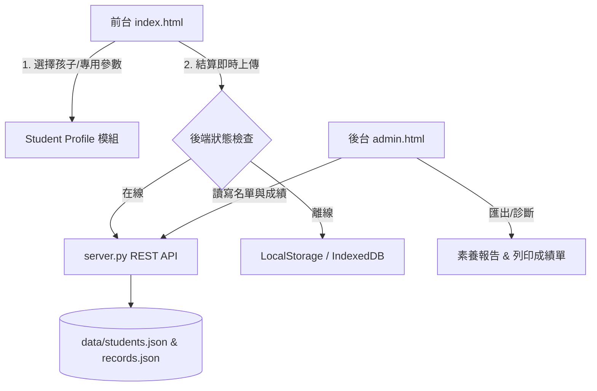

# 奇幻數學島 後台管理系統與學童專用追蹤計畫規劃書 (v2.8.0 規劃)

## 一、需求核心目標
1. **孩童專屬身份**：前台支援多孩童切換，或透過專屬 URL 參數（如 `?kid=101`）直接鎖定孩子身份。
2. **成績與歷程回傳**：遊戲通關、練習結束時，自動將分數、星數、答題耗時、錯題記錄上傳至後台。
3. **後台管理系統 (`admin.html`)**：
   - 孩童名單管理（新增、修改、刪除、角色頭像設定、專用連結/QR Code 生成）。
   - 學習歷程與成績看板（按孩子檢視 16 關通關進度、正確率、弱點章節統計）。
   - 成績單與報表匯出（支援列印與匯出 JSON / CSV）。
4. **雙軌相容原則**：
   - **伺服器模式**：由 `server.py` 提供極簡 REST API，持久化儲存於 `data/records.json` 或 SQLite。
   - **離線/PWA Fallback**：若無後端伺服器，自動降級儲存於 `localStorage`，不中斷遊戲體驗。

---

## 二、系統架構設計

---

## 三、三階段開發路線圖 (Herdr 管線)

### 階段 1：後端資料層與極簡 REST API (v2.8.0)
- **目標**：在 `server.py` 增加輕量 API，建立 `data/admin_store.json`。
- **端點規劃**：
  - `GET /api/students`：獲取所有學童清單。
  - `POST /api/students`：新增/修改學童。
  - `DELETE /api/students?id=...`：刪除學童。
  - `POST /api/records`：上傳遊戲紀錄（學童ID、關卡、得分、星數、時間、錯題）。
  - `GET /api/records?student_id=...`：查詢指定學童歷程。

### 階段 2：前台學童專屬模式與自動上傳 (v2.8.1)
- **前台新增學童切換器**：主選單顯示「目前挑戰者：大寶 ▾」。
- **支援專用連結**：訪問 `http://127.0.0.1:8000/?kid=kid_01` 自動鎖定該孩子，免手動選擇。
- **結算自動同步**：在 `js/game.js` 關卡過關結算時，發送成績至後台，離線時暫存隊列。

### 階段 3：獨立後台管理介面 `admin.html` (v2.8.2)
- **介面風格**：維持奇幻海島風格的深色/高質感家長儀表板。
- **功能模組**：
  1. **孩子管理卡片**：新增名字、自選頭像、一鍵複製「專用遊戲連結」。
  2. **學習戰報雷達圖**：各單元（加減法、數數、幾何）掌握度與星數統計。
  3. **歷史成績清單**：每次挑戰的時間戳、答題速度、失分分析。
